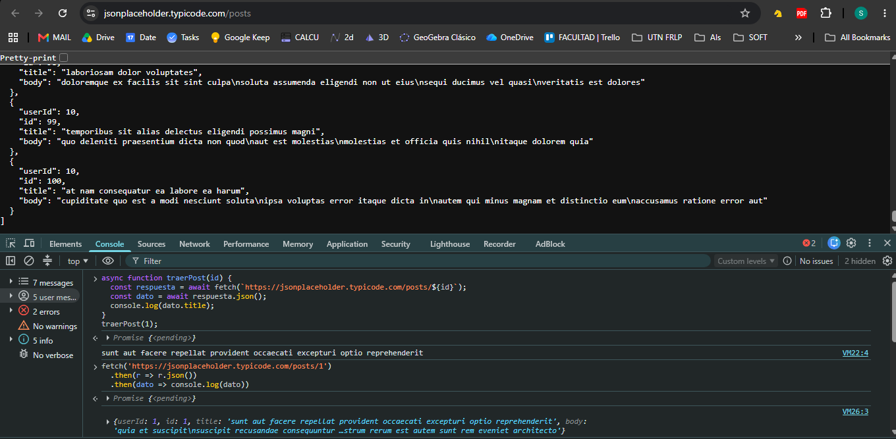

# Investigación — [Meccico, Santiago Carlos] (Legajo 33926)

## Parte A

### Preguntas guía
3.2 Búsquedas 
¿Qué es una SPA (Single Page Application) y en qué se diferencia de una página tradicional (MPA)?
    Una SPA es una aplicación o sitio web que carga un único documento HTML inicial y, a partir de allí, actualiza dinámicamente el contenido del cuerpo de la página mediante JavaScript a medida que el usuario interactúa con ella, sin necesidad de recargar la página completa desde el servidor.

    Se diferencia en que la página tradicional envía una solicitud HTTP al servidor, el cual renderiza y devuelve un nuevo documento HTML completo, recargando la    ventana en cada transición. Por el contrario, en una SPA el navegador descarga la estructura base una sola vez (HTML, CSS, JS), las navegaciones posteriores solo solicitan datos puros (comúnmente JSON mediante APIs) y el cliente redibuja únicamente las partes necesarias del DOM, ofreciendo una experiencia de usuario más fluida y similar a una aplicación de escritorio o móvil.

    Fuente: MDN Web Docs - Glosario: SPA (Single-page application)

¿Qué es una promesa (Promise) en JavaScript y para qué sirve? ¿Qué problema resuelve?

    Una promesa en JavaScript es un objeto que representa la eventual finalización (o fallo) de una operación asincrónica y su valor resultante. Básicamente, es un objeto que nos permite escribir código que parece síncrono (usando .then() y .catch() o async/await) para manejar resultados diferidos, como respuestas de red, temporizadores o accesos a bases de datos.
    
    El problema que resuelve es el "Callback Hell" (Infierno de Callbacks).
    Antes de las promesas (usando solo callbacks) tenia indentación excesiva, manejo de errores disperso y dificultad para seguir el flujo lógico. Las promesas solucionan esto permitiendo encadenar operaciones de forma lineal y limpia, facilitando la lectura, el mantenimiento y el manejo de errores.

¿Por qué fetch devuelve una promesa y no el dato directamente?
    JavaScript se ejecuta sobre un hilo único (single thread) con un bucle de eventos (Event Loop). Una petición de red mediante fetch es inherentemente lenta e indeterminada: involucra resolución DNS, latencia de red, tiempo de procesamiento del servidor y transmisión de bytes, lo cual puede tardar milisegundos o varios segundos.

    Si fetch devolviera el dato directamente de forma síncrona:
        - Bloquearía por completo el hilo principal de ejecución durante la espera.
        - La interfaz gráfica del navegador se congelaría (el usuario no podría scrollear, hacer clic en botones ni ver animaciones).
    Al devolver una promesa, el navegador delega la tarea de red en segundo plano (Web APIs) y permite que el hilo principal continúe ejecutando código. Cuando la respuesta llega, la promesa se resuelve y notifica al Event Loop para que entregue los datos sin haber bloqueado la interacción del usuario.

    Fuente: JavaScript.info - Fetch

¿Qué diferencia hay entre XMLHttpRequest (lo viejo) y fetch (lo actual)?
    Ambas son APIs del navegador diseñadas para realizar peticiones HTTP asíncronas, pero presentan diferencias sustanciales en diseño, sintaxis y capacidades:

    Sintaxis y Asincronía:

    XMLHttpRequest (XHR) está basado en eventos (onload, onerror, onreadystatechange). Requiere instanciar un objeto, configurar manejadores de eventos y llamar a métodos en varias líneas de código imperativo.

    fetch() se basa nativamente en Promesas, lo que permite encadenamiento directo con .then() y compatibilidad total con async/await, logrando un código mucho más limpio y declarativo.

    Manejo de Respuestas por Fases:

    En fetch(), la promesa se resuelve apenas se reciben los encabezados HTTP (objeto Response). Para obtener el cuerpo de los datos se debe llamar explícitamente a un método asíncrono complementario como .json(), .text() o .blob(), permitiendo manejar flujos de datos (streams).

    XHR maneja la respuesta completa en su propiedad responseText o response una vez finalizada la transferencia.

    Manejo de Códigos de Error HTTP:

    En fetch(), una respuesta con error de servidor (como 404 Not Found o 500 Internal Server Error) no rechaza la promesa; esta se resuelve exitosamente y requiere validar la propiedad response.ok. fetch solo rechaza la promesa si hubo un fallo de red a nivel conexión o si la solicitud fue bloqueada (por ejemplo, CORS).

    En XHR, los estados se evaluaban manualmente inspeccionando la propiedad status.

    Cancelación de peticiones:

    XHR cuenta con el método nativo xhr.abort().

    fetch no tiene un método interno directo, sino que se integra con el estándar universal AbortController / AbortSignal.

    Fuente: MDN Web Docs - Referencia de la Fetch API

3.4 Actividad guiada 

3.5 Preguntas guía (respondelas por escrito, en tu ticket)
    ¿Qué significa que fetch sea asincrónico? ¿Qué pasaría con la página si no lo fuera?
        Sigue la ejecucion sin esperar a que se resuelva, por eso es asincronico, se resuelve y avisa. Si fuera sincronico se bloquearia la pagina hasta que se resuelva la peticion.
    ¿Por qué respuesta.json() también devuelve una promesa?
        respuesta.json() devuelve una promesa principalmente porque el primer fetch() solo espera a recibir la cabecera del mensaje, por lo que el contenido real todavía está viajando en pedacitos por internet; además, como transformar todo ese texto en un objeto de JavaScript puede llevar tiempo si los datos son pesados, hacerlo de golpe congelaría la pantalla, así que el navegador usa una promesa para avisarte recién cuando terminó de descargar todo y convertirlo sin trabar la página
    ¿Qué relación hay entre una SPA y fetch? ¿Por qué la SPA "necesita" pedir datos así?

        La relación es que fetch es la herramienta principal que utilizan las SPAs (Single Page Applications) para obtener los datos dinámicos que necesitan sin recargar toda la página, permitiendo así una experiencia de usuario rápida y fluida. Como una SPA funciona con una única carga inicial, necesita pedir por partes lo que va apareciendo en pantalla, y fetch es ideal porque es asincrónico y versátil para manejar distintas fuentes de datos

## Parte B

4.2 Búsquedas
1. ¿Qué es un componente en React y por qué conviene dividir la UI en componentes?

    Un componente en React es una pieza de código independiente, reutilizable y modular (generalmente una función de JavaScript) que encapsula su propia lógica, estado y estructura visual para devolver lo que debe mostrarse en pantalla. Conviene dividir la interfaz de usuario en componentes porque permite aplicar el principio de separación de responsabilidades, facilita la reutilización de elementos visuales (como botones, tarjetas o formularios) en distintas partes de la aplicación y hace que el código sea significativamente más fácil de mantener, testear y escalar sin duplicar esfuerzos ni generar efectos secundarios imprevistos.

2. ¿Qué es JSX y por qué se parece a HTML pero no es HTML?

    JSX es una extensión sintáctica para JavaScript creada por React que permite escribir la estructura de la interfaz visual con una sintaxis declarativa y familiar muy similar a las etiquetas de marcado. Se parece a HTML porque toma prestados sus nombres de etiquetas, anidamientos y atributos básicos para que sea intuitivo de redactar, pero no es HTML real: es código JavaScript válido tras un proceso de transpilación (con herramientas como Babel o SWC) que convierte cada etiqueta en llamadas a funciones (React.createElement o el nuevo JSX transform). Al ser JavaScript por debajo, exige ciertas reglas propias (como usar className en lugar de class o htmlFor en lugar de for) y permite incrustar cualquier expresión dinámica de JS directamente entre llaves {}.

3. ¿Qué es el estado (useState) y en qué se diferencia de una variable común?

    El estado en React, manejado principalmente mediante el hook useState, es un objeto o valor interno administrado por el componente que almacena datos dinámicos que pueden cambiar a lo largo del ciclo de vida de la aplicación. La diferencia crítica con respecto a una variable común (como un let o const) radica en que React no rastrea las reasignaciones de variables locales ni las preserva entre ejecuciones: si modificás una variable común, el componente no se entera y el valor se reinicia en la siguiente llamada a la función; en cambio, al modificar el estado mediante su función actualizadora (setState), React conserva ese dato en memoria a través de las renderizaciones y dispara automáticamente un nuevo renderizado del componente para reflejar el cambio en la pantalla.

4. ¿Qué son las props y en qué se diferencian del estado?

    Las props (abreviatura de properties) son argumentos que un componente padre le pasa a un componente hijo para transmitirle datos, configuraciones o funciones de callback, funcionando de manera unidireccional y siendo estrictamente de solo lectura (inmutables) para el componente que las recibe. La diferencia principal con el estado es la propiedad y el control: mientras que el estado es privado, interno y mutable por el propio componente que lo declara para reaccionar a cambios locales (como la entrada de un formulario), las props provienen siempre desde afuera (desde el componente superior) y el hijo no puede modificarlas directamente, sirviendo como el mecanismo estándar de comunicación jerárquica de arriba hacia abajo.

5. ¿Por qué usar TypeScript en el frontend y qué problema te resuelve antes de que el código corra?

    Usar TypeScript en el frontend aporta un sistema de tipado estático sobre JavaScript que sirve como documentación viva del proyecto, mejora la experiencia de desarrollo con autocompletado inteligente y refactorizaciones seguras, y garantiza contratos claros entre componentes y APIs. El problema fundamental que resuelve antes de que el código corra (en tiempo de compilación) es la detección temprana de errores lógicos y de tipado, tales como intentar acceder a propiedades indefinidas (cannot read property of undefined), escribir mal el nombre de una prop, olvidar parámetros obligatorios o pasar un tipo de dato incompatible (como un número en lugar de un string), evitando que esos fallos se manifiesten como pantallas rotas o bugs silenciosos en el navegador del usuario final.